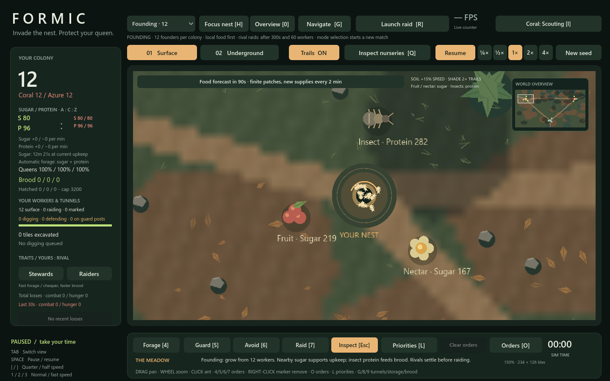
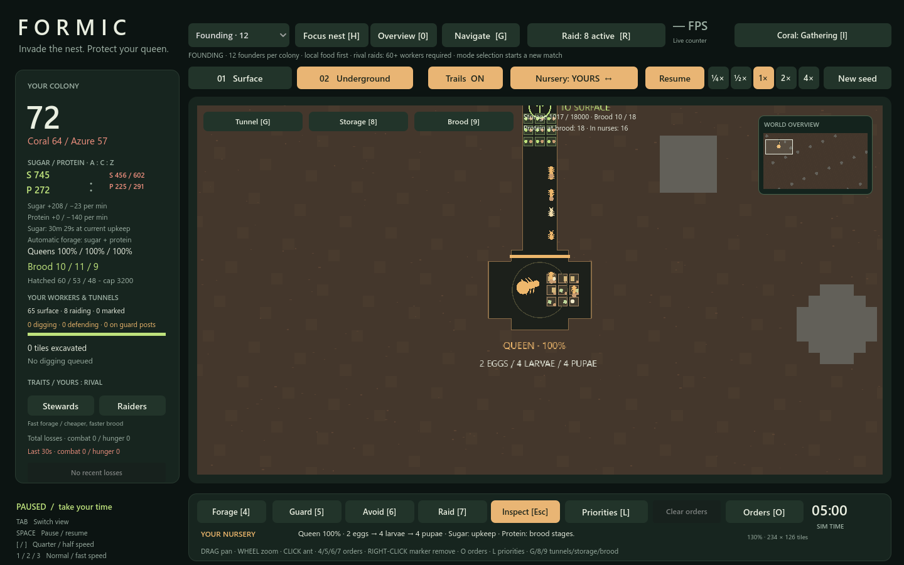

# Founding growth, local variety and longer matches

> Historical experiment: results, suite counts and reproduction commands describe the milestone tested. Later systems can change outcomes; rerunning today does not reconstruct that version. Use [Gameplay](GAMEPLAY.md), [Performance](PERFORMANCE.md) and the [Roadmap](ROADMAP.md) for current guidance. See the [documentation index](docs/README.md) for context.

Six configurations were run before and after the changes: seeds **81923, 404, 9973**, each with unattended Amber/player controls and with the equal-AI diagnostic controller. Matches ran for up to **30 simulated minutes**, stopping earlier if one queen remained. Five revised matches reached the full duration; one finished at 20 minutes 38 seconds. The observer continued after player defeat where necessary.

| Measure | Before | After |
|---|---:|---:|
| Workers per colony at 5 minutes, range | 17–31 | 51–74 |
| Workers per colony at 5 minutes, mean | 26.1 | 63.8 |
| Births per colony by first contact, mean | 10.1 | 36.0 |
| First detected contact, range | 120–214s | 188–311s |
| Ready brood waiting despite banked protein at 5 minutes, mean | 16.2 | 0.2 |
| Starvation losses | 0 | 0 |

Contact is sampled once per simulated second from actual enemy targeting; it is not a diplomatic state. The five-minute population measure can include early combat. The two revisions also differ in local source placement and quantities, as requested, so this is a comparison of the complete founding revision, not an isolated estimate of any one fix. Equal-AI and unattended-player cases serve different diagnostic purposes.

## What changed

- **Local variety with guarantees:** independent seeded generation gives each physical starting site different food distances, angles and quantities. Fruit guarantees 160–220 sugar, nectar 110–170 sugar, insects 220–300 protein, all 80–125 pixels from the nest. Worker and strategy RNG streams are untouched. Terrain already varies with the seeded garden.
- **Nursing that keeps up:** founding crews recruit roughly one nurse per twelve workers, capped at six and at one sixth of the population. Nurses prioritize ready hungry brood over unused tiles. Actual workers still walk to storage, carry at most four protein, and deliver to the actual brood tile. No food or brood progress is granted remotely.
- **Protein arrives earlier:** the first two-minute local replenishment is insect protein. Subsequent local waves cycle through fruit, nectar and insects, and continue after shared food begins at eight minutes. Forecasts top up existing cycle sites; full sites do not receive extra stock.
- **Local founding work:** during the first eight minutes, or while a colony remains below 60 workers, unassigned collectors favor available local sources according to nutrient shortage. One in seven worker identities remains a scout. Explicit player/AI orders, loaded couriers, combat, nurses and other jobs take precedence. There is no invisible border or immunity from combat.
- **Economical early defense:** unthreatened rival colonies below 40 workers do not keep a standing tunnel garrison. Real nest invasions still trigger defense. The existing five-minute/60-worker automatic raid gate remains in force.

## Skirmish and verification

All production changes are conditional on Founding. Three fixed-seed skirmish traces, each **1,200 ticks / 40 simulated seconds** with 6,000 initial workers, produced **identical SHA-256 fingerprints before and after**. The fingerprints include worker positions, roles, health, cargo, individual RNG states, resources, brood, room buffers, tunnels and AI orders/target RNG.

The 22 suites passed across the full existing suite run and the targeted mode/logistics checks. The mode test's old expectation that a repeated full local source receives another 360 units was corrected to assert the existing top-up rule, then rerun successfully. New checks cover reproducible varied supplies, guaranteed resources, independent RNG, nurse recruitment, hungry-room priority, physical protein delivery, standing-guard economy, local guidance/scouting, explicit-order precedence, guidance release and continued local supplies. Native/reference founding traces still agree through worker births.

Data: `tests/founding_long_before.json`, `tests/founding_long_after.json`, `tests/founding_long_comparison.json`, `tests/founding_logistics_verification.json`. All sampled worker states were valid; populations reconciled with births/losses, and protein covered both room buffers and nurse loads. No artificial workers or ongoing food grants were used.

## Next steps at the time of this experiment

Scouting and raid escalation have since shipped. This section preserves the reasoning at that point; use the [Roadmap](ROADMAP.md) for outstanding work.

Growth is now strong enough for the existing raid system to become the main pressure. Azure was eliminated in five of six revised configurations, and mature colonies can still settle into attrition after their opening growth. These few seeded runs do not establish balanced win rates.

The next useful milestone is **scouting and readable territorial pressure**: show newly discovered sources, dangerous routes and incoming raids so the player can decide when to expand, escort a food route or reinforce a corridor. Then vary the surrounding garden more deliberately—short exposed soil routes versus longer shaded routes, rich but distant protein versus safer sparse supplies—while preserving guaranteed starter food. Tune escalation against those decisions before adding skill trees or large passive bonuses.

## Renderer checks

Five live 4× GL renderer windows, at 1440×900 and 0/180/600/1200/1800-second checkpoints, all passed. Checkpoints advance via full fixed ticks between five-second renderer windows. All individual workers remain active.

| Checkpoint | Mean FPS | p95 ms | Actual speed |
|---|---:|---:|---:|
| founding_0s | 819.6 | 1.37 | 4.00× |
| founding_180s | 1071.6 | 1.17 | 4.00× |
| founding_600s | 652.0 | 1.90 | 4.00× |
| founding_1200s | 661.8 | 1.82 | 3.99× |
| founding_1800s | 621.5 | 1.99 | 4.00× |

These are natural founding populations, not 2,000-per-colony stress fixtures. The existing skirmish performance report remains historical; this revision verifies skirmish rules with exact deterministic traces and existing rule suites.

