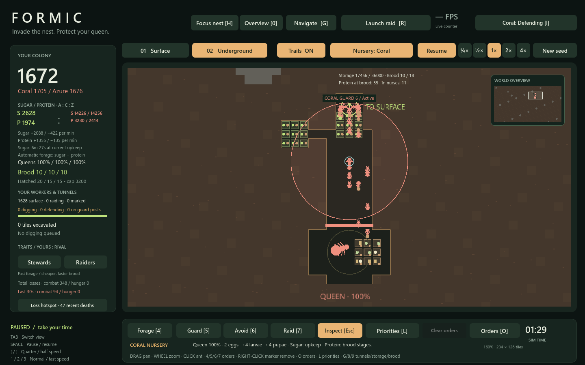
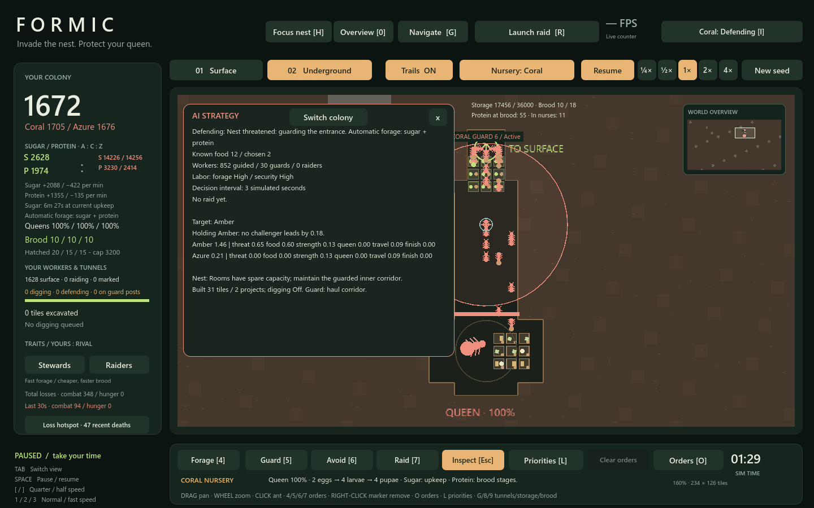

# Rival nest planning

> System reference and milestone evidence. [Gameplay](GAMEPLAY.md) owns current player rules; [Performance](PERFORMANCE.md) owns the latest benchmark baseline. Measurements and suite counts below belong to this milestone unless explicitly identified as current. See the [documentation index](docs/README.md) for related systems.

Coral and Azure now expand and defend their own underground nests. Press **Q** to cycle nests and **I** to inspect a rival's current project and its reason. Construction highlights and room outlines appear in the inspected nest; its corridor guard marker remains visible underground even with the strategy panel closed.

## Decisions and worker costs

The planner runs with the existing three-second AI decision cadence, with a twelve-second cooldown between projects. Each rival keeps one construction project at a time. Designations do not create tunnels, food, brood or capacity: recruited diggers walk through that colony's own entrance, reach an accessible work face, and excavate the actual soil. Up to two workers share a work face. Finished crews return through the entrance and resume foraging.

- **Storage:** add a connected 3×3 room when reserves reach 70% of usable capacity, or capacity cannot hold 40 seconds of worker upkeep. Each excavated storage tile adds the existing 2,000 capacity. Storage sites sit near the entrance to keep deliveries short.
- **Brood:** add a connected 3×3 room when at least 75% of existing slots are occupied, protein is at least 16, and sugar covers 45 seconds of upkeep. Desired capacity follows population (one slot per 80 workers, minimum 18, maximum 80). At 2,000 workers this requests a second room once the first fills. New brood space still requires nurses to deliver protein before eggs can use it.
- **Routes:** compare up to four nursery destinations with existing paths, and excavate a safe elbow shortcut when it saves more than four tiles. Shortcuts avoid stone and do not break new walls within four tiles of the queen. A busy shaft can also request one 20-tile widening project, preserving its inner defensive throat.
- **Defense:** normally station six real guards in the forward haul corridor. During an invasion move the post to the inner junction and allow up to twelve guards. Posts share the existing maximum of 48 security workers, including raids and surface guards; committed raids keep their existing priority.
- **Emergencies:** do not start projects below 40 workers, below 25 seconds of sugar, or during an invasion. Existing work stays queued. Recovery or defense reduces digging to six workers; otherwise active construction may recruit up to 24. Dead queens release their construction and order crews.

Finite room sites, stable projects, bounded route checks and cached room flow maps keep planning out of each ant's hot loop. Worker movement, food handling, combat, nurse loads and per-worker random streams remain individual. Both rival colonies use the same construction rules and local site offsets. The small guard parties are intended to improve nest defense, not establish perfect match balance.

## Verification

`./play.ps1 -Test` includes `tests/nest_planner_test.gd`, covering both rival colonies and both simulation kernels: actual storage and brood excavation, project stability, capacity activation, crew release, physical corridor posts, traffic-lane construction, a measured route shortcut, emergency priorities, labor limits, queen death and reset. Its construction fixtures use small live crews for fast reference-kernel checks; renderer benchmarks retain 2,000 initial workers per colony.

Performance results are recorded in `tests/nest_planner_performance.json` (the same nine natural/provisioned room-logistics windows) and `tests/nest_construction_performance.json` (three explicit storage/brood/route construction stress windows with the rival panel open). Measurements use the real 1440×900 GL renderer, uncapped FPS, requested 4×, five-second windows, and all individual ants. Natural checkpoints use full fixed ticks between renderer windows. Provisioned workloads are synthetic and labeled as such. Other projects' Godot instances are not stopped.

1440×900 renderer results on the available RTX 4070 Ti SUPER:

| Workload | Mean FPS | p95 frame ms | Actual speed |
|---|---:|---:|---:|
| food_natural_0s | 202.7 | 8.22 | 3.99× |
| food_natural_90s | 170.2 | 10.79 | 4.01× |
| food_natural_120s | 208.1 | 8.34 | 4.00× |
| food_natural_240s | 197.8 | 8.82 | 4.00× |
| food_natural_360s | 212.7 | 8.19 | 4.00× |
| food_2000_panel_overview | 119.9 | 14.68 | 4.01× |
| food_2000_panel_battle | 95.7 | 21.70 | 4.01× |
| food_2000_panel_detail | 104.9 | 25.50 | 4.02× |
| food_2000_panel_arrival | 137.1 | 13.45 | 4.00× |
| underground_rival_storage | 235.6 | 7.29 | 4.00× |
| underground_rival_brood | 231.4 | 7.56 | 4.00× |
| underground_rival_route | 237.9 | 7.79 | 4.00× |

In the natural run, both rivals expanded storage from 18,000 to 36,000 capacity by the 360-second checkpoint.

All **20 test suites** and **12 renderer windows** passed. Across the windows, mean FPS was **95.7–237.9** and actual speed **3.99–4.02×**. All windows ran their full five seconds with valid worker states and reconciled population/room-inventory checks. The performance gate is mean ≥60 FPS, p95 ≤33.3 ms, and actual simulation speed ≥3.9×; it does not promise every frame stays below 16.7 ms.

In the construction windows, each rival excavated **12 storage/connector tiles**, **9 brood tiles**, and **20 widening tiles**, respectively. Queues emptied in all three cases. These are provisioned stress cases; the normal planner waits for the corresponding resource, brood or traffic pressure.

Founding nursery anticipation: specialized rivals can queue the daughter nursery at 60 workers, targeting 24 connected slots with at most six preparation diggers. Existing affordability, cooldown, invasion safety and actual excavation remain required. Skirmish keeps its original policy. See [Clarity](CLARITY.md).
