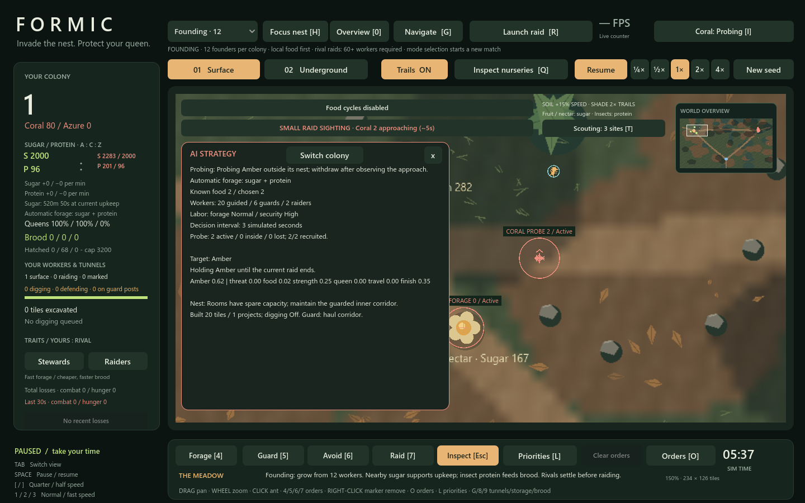
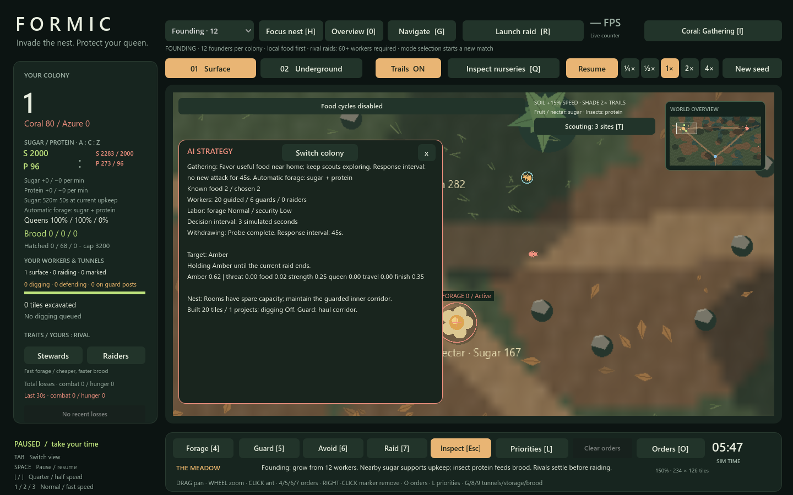

# Rival raid escalation

> System reference and milestone evidence. [Gameplay](GAMEPLAY.md) owns current player rules; [Performance](PERFORMANCE.md) owns the latest benchmark baseline. Measurements and suite counts below belong to this milestone unless explicitly identified as current. See the [documentation index](docs/README.md) for related systems.

Rival AI attacks now develop through a small surface probe, withdrawal, a response interval and a re-evaluated full invasion. This applies in Skirmish and Founding. Press **T** for actual scouting reports and **I** for the rival's diagnostic phase/reason. **Player-issued Raid orders remain direct attacks.** Existing direct/legacy dispatch helpers retain their meaning; escalation belongs to the rival strategic controller (and the equal-controller diagnostic AI).

## Phases

1. **Probe:** recruit 2–6 actual workers (roughly one per 40 living workers, bounded to that range). The party uses the existing shared security budget, carries no new combat bonuses, and cannot recruit replacement waves. It approaches a point 180 pixels outside the target entrance, on the side facing its home. Its surface order goal prevents it from entering the target's tunnels.
2. **Observe:** at least one active member must remain within 50 pixels of that approach point for at least eight simulated seconds, checked at the usual three-second AI cadence. Fighters still encounter enemies, take damage and die normally. The travel allowance plus hold time is bounded by a 35–85-second probe deadline.
3. **Withdraw and respond:** surviving probe members switch to a real return-home mission. They are not teleported away or allowed to keep recruiting and harassing the entrance. A completed probe allows no new campaign for at least **45 simulated seconds**, about 11 wall seconds at 4×, in addition to the later invasion's travel time.
4. **Invasion:** after the interval, ordinary food, strength, recovery, home-threat and target checks run again. A qualified larger campaign uses the existing party limit (up to 12/24, further limited by colony population and shared labor), bounded replacement budget (twice the party size), tunnel travel, queen attacks and progress-based commitment. The old 180-second hard campaign limit remains.

Probe information belongs to the actual rival colony, expires after ten simulated minutes and is consumed when an invasion starts. Changing targets does not let a successful probe against one nest authorize an immediate invasion of another. Each later campaign needs fresh reconnaissance.

## Repelled attacks and emergencies

Losing half the small party, exhausting its fixed roster, running out of time or suffering a food/home emergency causes withdrawal. Unsuccessful probes wait **75 seconds** before another attack. A single failed probe does not unlock a full invasion.

To avoid endless tiny attacks against a weak remnant, two recent repelled probes can justify a delayed full invasion only when the attacker has at least a **25% population advantage**, or the existing finishing-opportunity rule applies. The full 75-second response interval and all ordinary safety/resource checks still apply. Against a comparable strong opponent, the AI continues with probes or waits rather than escalating blindly.

Founding retains its existing initial five-minute/60-worker automatic-attack gate. Target elimination, home queen danger, insufficient food, party losses, pause, victory/defeat and reset retain their existing effects. Worker identities protect rosters from reused array slots.

## Scouting warnings

Warnings continue to use observed worker positions and movement, not hidden rival order markers or AI phase state. Up to six observed raiders receive a **SMALL RAID SIGHTING** label; this describes the visible party, not certainty that it is a probe. A small visible group could also be part of a larger force. Stationary nearby raiders are labeled **near entrance** rather than given a false moving-arrival estimate. Real intruders receive the higher-priority **NEST BREACH** banner.

Scouts must see an attack to report it; escalation does not disclose unseen intent. The probe and response interval provide time to scout, move a Guard post, mark Avoid or protect a food route before a larger force arrives.

## Verification

`play.ps1 -Test` includes `tests/raid_escalation_test.gd`. In both modes and both simulation kernels it runs real probe workers from home to the forward point, checks no tunnel entry/queen damage, observes a real scout warning, watches withdrawal and waits through the response interval before a larger invasion starts. It also covers fixed probe budgets, repelled probes, stronger follow-ups after two failures, stale/target-specific reconnaissance, emergency recalls, manual player orders and reset.

The older sustained-invasion fixtures now explicitly establish a prior completed probe so their original purpose—roster identity, replacements, queen-progress extensions, hard limits and small-colony finishes—continues to be tested independently.

In the physical fixtures, the 2-ant probe preceded a 16-ant invasion. The first scout warning was about **57.5 simulated seconds** before the larger launch in Skirmish, and **59.2 seconds** in Founding; both kernels produced matching timings. The actual response interval after withdrawal was 46.7 seconds because decisions are sampled at the established strategy cadence. These are staged safe-approach fixtures, not guaranteed warning lead times in every match.

Renderer reports are `tests/raid_escalation_skirmish_performance.json` and `tests/raid_escalation_founding_performance.json`. They retain individual 30-Hz worker simulation, requested 4×, the 1440×900 GL renderer, five-second live windows and open scouting/territory reports. Skirmish includes the established provisioned 2,000-per-colony battle workloads; Founding uses natural growth. Checkpoint gaps use full fixed ticks. Phase telemetry separates probes, completed probes and invasions; the legacy total-start counter now includes both attack types.

## Renderer results

All **24 suites** and **14 live renderer windows** passed. A final targeted run also covered comparable-strength opponents after repeated failures, interrupted approach holds and home-queen elimination. Sampled worker states, population accounting, protein allocation, storage limits and actual raid recruitment budgets all reconciled. No probe entered the rival tunnels in the sampled windows.

| Workload | Mean FPS | p95 frame ms | Actual speed |
|---|---:|---:|---:|
| food_natural_0s | 193.8 | 8.83 | 3.99× |
| food_natural_90s | 147.0 | 12.75 | 3.99× |
| food_natural_120s | 170.2 | 11.25 | 4.00× |
| food_natural_240s | 163.7 | 11.26 | 4.00× |
| food_natural_360s | 180.1 | 10.02 | 4.00× |
| food_2000_panel_overview | 134.2 | 13.05 | 4.00× |
| food_2000_panel_battle | 91.1 | 22.26 | 4.02× |
| food_2000_panel_detail | 89.5 | 30.30 | 4.01× |
| food_2000_panel_arrival | 149.8 | 12.24 | 4.00× |
| founding_0s | 922.4 | 1.40 | 4.01× |
| founding_180s | 680.4 | 4.49 | 4.00× |
| founding_600s | 597.6 | 2.47 | 4.00× |
| founding_1200s | 569.9 | 3.04 | 4.00× |
| founding_1800s | 440.2 | 5.38 | 4.00× |

The dense 2,000-initial-workers-per-colony battle windows averaged **89.5–91.1 FPS** at requested 4×. Natural Founding windows averaged **440.2–922.4 FPS** with their actual growing populations, not provisioned 2,000-worker colonies. The gate is mean ≥60 FPS, p95 ≤33.3 ms and actual speed ≥3.9×; this does not guarantee every frame stays below 16.7 ms.

The captures below are staged safe-approach fixtures with actual ants, orders, scout observations and physical travel, used to show each phase clearly.

