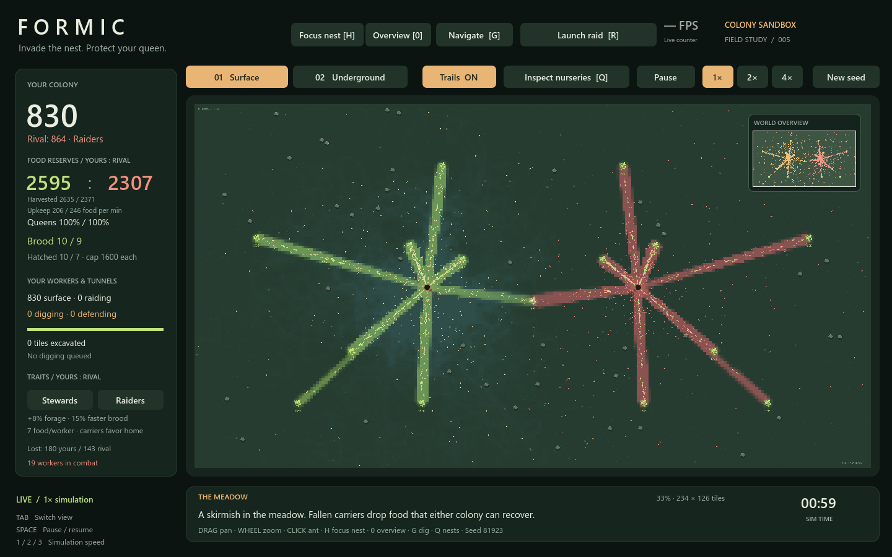
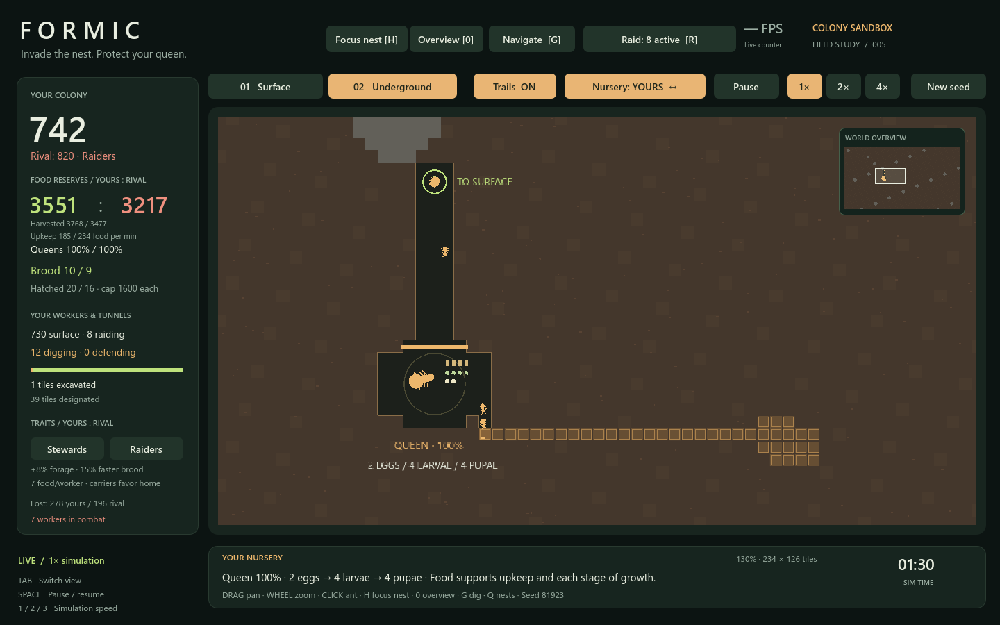
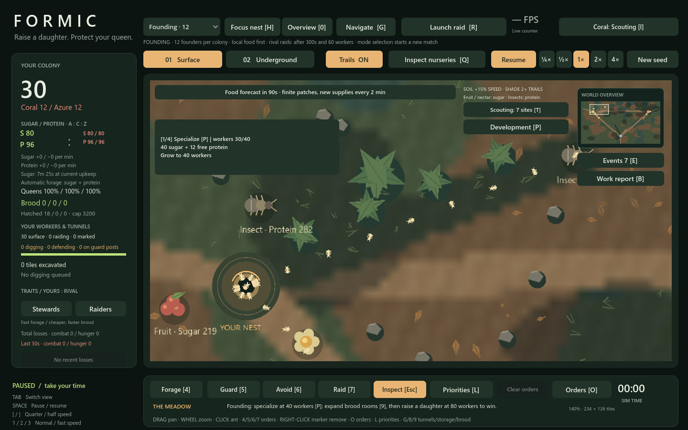

# Formic — ant colony sandbox

[](https://godotengine.org/)


**Invade the nest. Protect your queen.**

Formic is a real-time strategy sandbox about directing a colony of thousands of *individual* ants. Lead Amber against two rival colonies, Coral and Azure. Find food, follow pheromone trails, excavate chambers, guard your routes and invade rival nests. Workers physically move, carry, fight, nurse brood and dig. Your orders guide that work; they never replace it.



## Highlights

- **Individual ants.** Every worker has its own health, age, cargo, role and random stream. Click one to inspect it and follow it between the surface and the nest.
- **Pheromone logistics.** Foragers sense and follow scent trails. Forage markers bias recruitment, and local sensing decides actual pickups. Sugar fuels upkeep and protein feeds brood.
- **Real nests.** Designate tunnels, storage and brood chambers. Nurses and couriers walk the physical corridors, and raiders fight through them to reach the queen.
- **Capable rivals.** Rival AI ranks food and targets, expands its nest, probes your defenses and then commits to staged raids. You can read its plan in the in-game AI view.
- **Two modes.** *Skirmish* starts at 2,000 workers per colony and ends when both rival queens die. *Founding* starts at 12 workers: specialize, expand and raise a daughter queen before the rivals do.
- **Readable by design.** Clickable event history, per-order delivery and loss reports, scouting and raid warnings, and a Founding objective tracker explain what is happening and why.
- **Fast.** A native C++ GDExtension accelerates the hot loops, with a GDScript fallback. Dense battle views averaged 133–193 FPS in testing.

| Underground nest | Strategic food routes |
| --- | --- |
|  |  |

## Quick start

**Requirements:** Windows x64 and [Godot 4.7.2](https://godotengine.org/download/archive/). The Windows native extension (`native/bin/ant_kernel.dll`) is included, so no compiler or rebuild is needed.

```powershell
git clone https://github.com/jbax-and-his-ai-pals/011-ants.git
cd 011-ants
```

Then either open `project.godot` in Godot and press **F5**, or run the launcher:

```powershell
.\play.ps1                 # play
.\play.ps1 -Editor         # open the editor
.\play.ps1 -Test           # run the rule suites
.\play.ps1 -GodotPath 'C:\path\to\Godot_console.exe'   # use a specific executable
```

`play.ps1` looks for the Godot console executable under your Downloads folder by default; pass `-GodotPath` if yours lives elsewhere. To launch directly into Founding at 4× speed:

```powershell
& 'C:\path\to\Godot_console.exe' --path . -- --mode=founding --speed=4
```

## Modes

| Mode | Opening | How to win |
| --- | --- | --- |
| **Skirmish** (default) | 2,000 workers per colony, nearby rivals, equal supplies | Kill both rival queens |
| **Founding** | 12 workers per colony, varied local supplies | Specialize at 40 workers, expand brood space, raise a daughter queen from 80 workers |

The mode selector starts a new match. **New seed** keeps the selected mode.

## Controls at a glance

| Control | Action |
| --- | --- |
| Drag / wheel | Pan / zoom |
| Click an ant | Inspect it |
| **Tab** | Switch between surface and nest |
| **4 / 5 / 6 / 7** | Place Forage / Guard / Avoid / Raid orders |
| **G / 8 / 9** | Designate tunnels / storage / brood chambers |
| **O / L / T / I** | Orders, labor, scouting, rival AI panels |
| **E / B** | Event history / work report |
| **Space**, **[ ] 1 2 3** | Pause and change speed (¼× to 4×) |

The full list is in the [player guide](GAMEPLAY.md).

## Documentation

| Document | Owns |
| --- | --- |
| [Gameplay](GAMEPLAY.md) | Controls, modes, economy, planning, scouting and combat |
| [Roadmap](ROADMAP.md) | Proposed next milestones and completion criteria |
| [Performance](PERFORMANCE.md) | Simulation constraints, measured baseline and verification commands |
| [Reference and history index](docs/README.md) | System notes, balance experiments and design rationale |
| [Native development](native/README.md) | Kernel boundaries, rebuild procedure and licenses |

## Project layout

| Path | Contents |
| --- | --- |
| `scripts/` | GDScript simulation, UI and rival AI |
| `native/` | C++ GDExtension kernel, build scripts and prebuilt Windows DLL |
| `tests/` | Rule suites, seeded map checks and balance result data |
| `screenshots/` | Captures referenced by the design documents |

## Status

This is an actively developed prototype. The current baseline passed 28 rule suites, 24 seeded map accessibility checks and 12 renderer windows at 4× speed. Pacing, interface and large-scale balance are still open questions; see the [roadmap](ROADMAP.md).

## License

No license has been chosen yet, so all rights are reserved by default. The bundled godot-cpp bindings and runtime libraries keep their own licenses; see [native/README.md](native/README.md#licenses).
