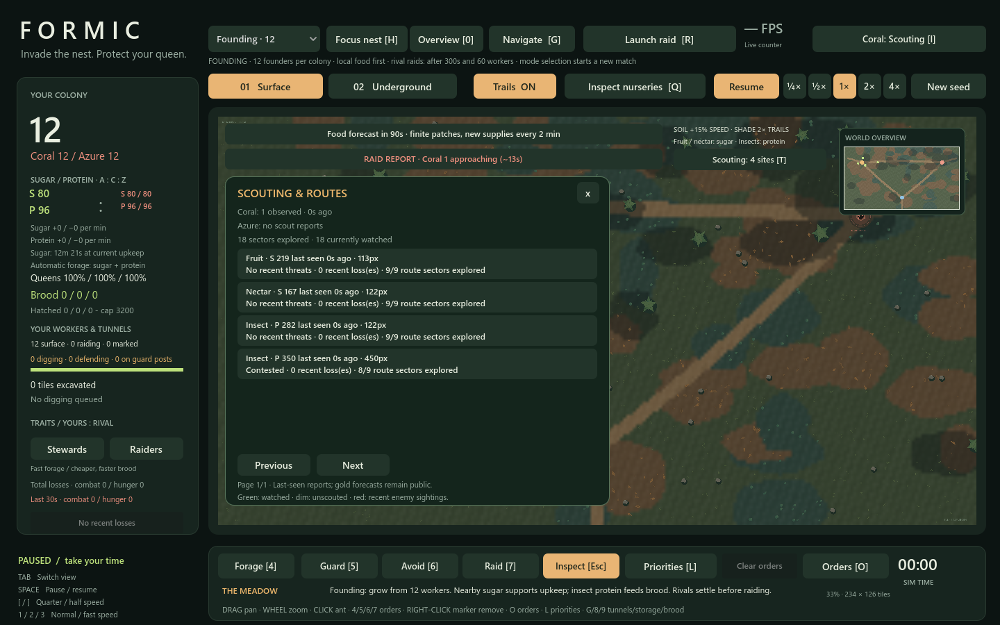
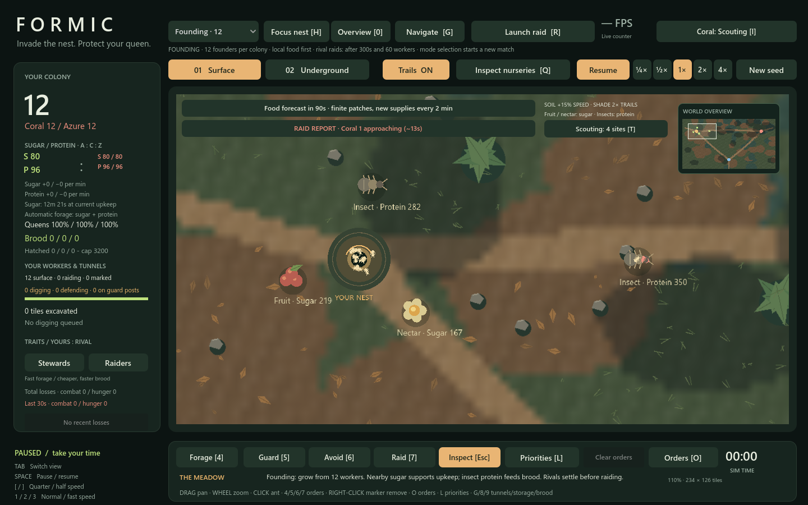
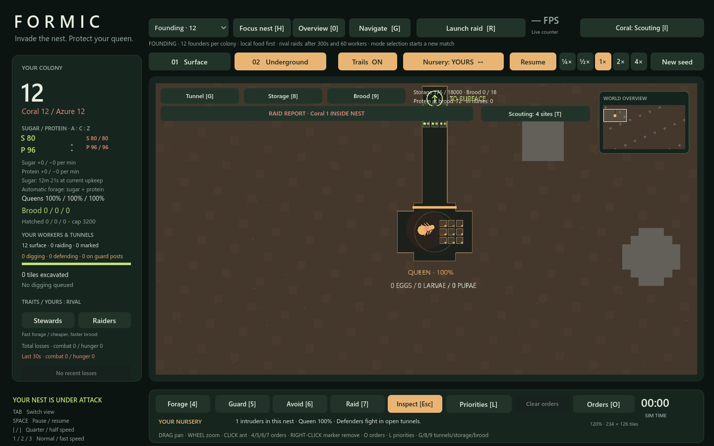

# Scouting and territory reports

> System reference and milestone evidence. [Gameplay](GAMEPLAY.md) owns current player rules; [Performance](PERFORMANCE.md) owns the latest benchmark baseline. Measurements and suite counts below belong to this milestone unless explicitly identified as current. See the [documentation index](docs/README.md) for related systems.

Press **T** or click **Scouting** below the food/terrain notices. Your ants share observations from their current and neighboring **96-pixel sectors**. The nest entrance remains watched while your queen is alive. This works in both Skirmish and Founding, without assigning a special scout job or changing any worker's movement, combat, food handling or random stream.

Current food reports also show nutrient purpose, nominal surface round-trip seconds and sampled soil/shade coverage. Estimates include loaded return and current colony speed, excluding wandering, combat and tunnel delivery. See [strategic garden](STRATEGIC_GARDEN.md); the original milestone measurements below remain historical.

## Discoveries and territory

Natural food sites appear on the surface and minimap after scout coverage reaches them. Reports remember the last observed quantity, food/resource type, distance from home and observation age. Leaving a source does not keep refreshing its stock remotely; revisiting updates it, including depletion. Dropped cargo remains a small visible ground detail and does not fill the food-source list.

Public replenishment forecasts retain their gold rings and arrival announcements. They reveal a future source location, not its current stock. A source's quantity is still reported only when watched.

With reports open, the territory overlay tints watched sectors green, leaves previously explored sectors lightly marked, dims unscouted sectors and highlights recent enemy-sighting sectors red. These are information areas, not ownership or movement restrictions. Each food row focuses its remembered source and closes the panel so the location is visible; existing Forage, Guard and Avoid orders remain the way to act on the information. Previous/Next pages cover remembered sites beyond the first six.

The existing sandbox still renders individual enemy ants and exposes its nursery/AI inspection tools. This milestone adds discovery-based food information and scouting-based activity/alerts; it does not introduce full fog of war or hide the debug inspection tools.

## Route danger and activity

The route overlay estimates a **straight-line corridor** from home to the remembered source, using a 110-pixel corridor radius. It reports nine sampled sectors of exploration coverage. It does not claim to reconstruct a particular ant's route through the garden.

- **High danger:** at least eight enemies observed together in a corridor sector, or at least three of your recent losses in the corridor.
- **Contested:** any recent enemy sighting or your recent loss in the corridor.
- **Partly scouted:** no recent threat evidence, but some route sectors have never been explored.
- **No recent threats:** the corridor has been explored and currently has no unexpired danger evidence. This is not a guarantee of safety.

Enemy-sector evidence expires after **20 simulated seconds**, or clears when a watched sector is empty. Your surface losses contribute for **30 simulated seconds**. Peak sector density avoids counting a single traveling enemy as a whole army. Enemy activity rows show each colony's most recent observed group count and age, not its hidden total population.

## Incoming raids

The red **RAID REPORT** banner appears when scouts observe enemy raiders closing on your entrance within 1,000 pixels, or raiders are already within 260 pixels. Direction comes from consecutive observed positions and projected approach, not hostile order markers, AI target choices or hidden rosters. A distant stationary enemy or unseen raid order does not trigger an incoming warning.

Click the banner to focus the observed group. An actual breach focuses your underground nest and takes precedence over a surface warning. Arrival estimates use observed closing speed and are approximate. An unwatched warning lasts up to **12 simulated seconds** with its report age; a visible withdrawal or cleared breach removes it sooner. These are sightings, not guaranteed enemy intentions. Pause freezes the report clocks, and restarting clears all memories.

## Work and performance bounds

Scouting samples at the existing **0.8 simulated-second allocation cadence**, independent of frame rendering. Surface scouts are grouped into occupied sectors before their visibility is expanded. Enemy workers are visited once; motion histories are retained only for potential raiders or intruders, not every hostile collector. Food discovery rotates through at most 64 array entries per scan, refreshes at most 64 remembered sources, and explicitly checks public pending sites. Loose cargo piles do not consume food memory. Route losses are aggregated by sector once, and the territory tint is a cached 35×19 texture drawn as one rectangle. No ants are combined or skipped from simulation.

`play.ps1 -Test` includes `tests/scouting_test.gd` for real discovery/revisits/staleness, forecast limits, observed approaches, unseen-order isolation, threat clearing, route evidence/expiry, nest breaches, focus, UI/pause/reset, RNG isolation and bounded food work in both modes. The existing native/reference individual-worker checks remain active.

Performance artifacts: `tests/scouting_skirmish_performance.json` (nine established natural/provisioned 2,000-worker-per-colony workloads) and `tests/scouting_founding_performance.json` (five natural growth checkpoints through 30 simulated minutes). Both run the real 1440×900 GL renderer at requested 4× with the scouting panel and territory overlay open. Natural checkpoint gaps use full fixed ticks; provisioned battles are synthetic and labeled. Reports include scan cost, remembered-site and tracked-raider counts.

## Recorded results

All **23 suites** and **14 renderer windows** passed. Individual-worker native/reference checks retained their 0.002-pixel tolerance, and the scouting tests verify that no worker or AI random stream is consumed. Every renderer sample had valid worker states and reconciled births, losses, storage and nurse allocations.

| Workload | Mean FPS | p95 frame ms | Actual speed |
|---|---:|---:|---:|
| food_natural_0s | 255.5 | 6.50 | 4.00× |
| food_natural_90s | 189.5 | 9.86 | 4.00× |
| food_natural_120s | 215.1 | 8.15 | 4.00× |
| food_natural_240s | 203.5 | 8.33 | 4.00× |
| food_natural_360s | 195.7 | 8.82 | 4.01× |
| food_2000_panel_overview | 170.0 | 10.64 | 4.00× |
| food_2000_panel_battle | 119.7 | 17.48 | 4.00× |
| food_2000_panel_detail | 94.6 | 27.89 | 4.03× |
| food_2000_panel_arrival | 180.3 | 10.11 | 4.00× |
| founding_0s | 1004.2 | 1.16 | 4.00× |
| founding_180s | 1028.2 | 1.22 | 4.00× |
| founding_600s | 631.3 | 2.13 | 4.00× |
| founding_1200s | 550.3 | 2.30 | 4.00× |
| founding_1800s | 533.9 | 2.24 | 3.99× |

Skirmish scouting scans peaked at **5.017 ms** in these workloads; moving-enemy history remained limited to actual observed raiders/intruders. The performance gate is mean ≥60 FPS, p95 ≤33.3 ms and actual speed ≥3.9×. This does not promise that every frame is below 16.7 ms. Provisioned skirmish windows start with 2,000 ants per colony; actual battles reduce populations. Founding windows use naturally grown colonies, not 2,000-worker fixtures.

The screenshots below are staged observation fixtures using actual scout and raider positions, to show the reports and warning states clearly.

